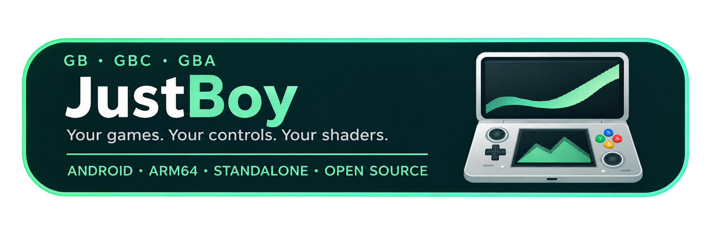

<p align="center"></p>
<p align="center">
  
  
  
  
</p>

# JustBoy

A standalone Android frontend on [libmGBA](https://github.com/mgba-emu/mgba). It plays **Game Boy, Game Boy Color, and Game Boy Advance**.

It is not a fork of mGBA’s Qt or Android UI. The Android shell started from [carterprince’s JustGBA](https://github.com/carterprince/JustGBA); see [credits](#credits-and-licenses).

## Features

- GBA, GB, and GBC
- Physical-controller first (no on-screen pad)
- Remappable buttons and hotkeys: pause, fast-forward hold/toggle, save, load
- Three manual save slots plus autosave
- Cheats (CodeBreaker and common GB/GBC formats)
- Video shaders: Sharp, Smooth, 2xBR, optional original GBA colors, two imported GLSL passes
- Screen size: Fit, integer scale, or a locked 2x–7x
- Tabbed settings: General, Video, Controller, Hotkeys, Saves, Cheats
- Saves default to the `Saves` folder on the SD card, and the folder can be changed
- Dark theme: On, Off, or Follow system

## Build from source

libmGBA 0.10.5 is vendored in `vendor/mgba`; no extra clone is needed.

Requirements:

- JDK 17
- Android SDK platform 34 and build-tools 34.0.0
- NDK **26.1.10909125**
- CMake **3.22.1**

On Windows PowerShell:

```powershell
$env:JAVA_HOME = 'C:\path\to\jdk-17'
.\build.ps1 -AndroidSdk 'C:\path\to\Android\Sdk'
```

On Linux/macOS:

```sh
export JAVA_HOME=/path/to/jdk-17
export ANDROID_HOME=/path/to/android-sdk
./gradlew testDebugUnitTest assembleRelease
```

The APK is generated at `app/build/outputs/apk/release/app-release.apk`. Local release builds currently use a development signing certificate. Your self-built APK will not update an APK signed with a different certificate. Keystores, credentials, caches, and local SDK paths are excluded from source control.

## Credits and licenses

| Component | Original authors / source | License / notice |
| --- | --- | --- |
| Android frontend (started as) | [carterprince / JustGBA](https://github.com/carterprince/JustGBA) | GPL-2.0; [original README](docs/UPSTREAM-README.md), [LICENSE](LICENSE) |
| libmGBA | [endrift / mGBA](https://github.com/mgba-emu/mgba) | MPL-2.0; [vendored source](vendor/mgba), [LICENSE](vendor/mgba/LICENSE) |
| xBR-lv2 / 2xBR | Hyllian (with acknowledged ideas from Joshua Street's SABR) | MIT-style permission notice retained in [shader source](app/src/main/assets/shaders/2xbr.glsl) |
| GBA color shader | hunterk; modifications by Pokefan531 | Public domain, original header retained in [reference source](app/src/main/assets/shaders/gba-color-reference.glsl) |

Upstream copyright and license notices are retained. Naming Nintendo, GBA, GB, or GBC describes compatibility and does not imply affiliation or endorsement.

### Development notes

This frontend was developed by **pedalstool** with implementation help from OpenAI Codex and Cursor. Feature requirements and handheld testing came from the project owner. AI assistance is not a claim of authorship of the original emulator, Android application, or third-party shaders.
